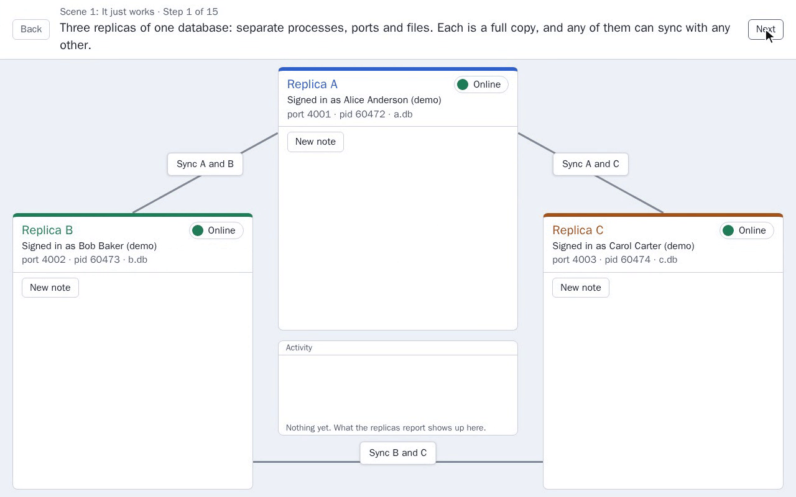
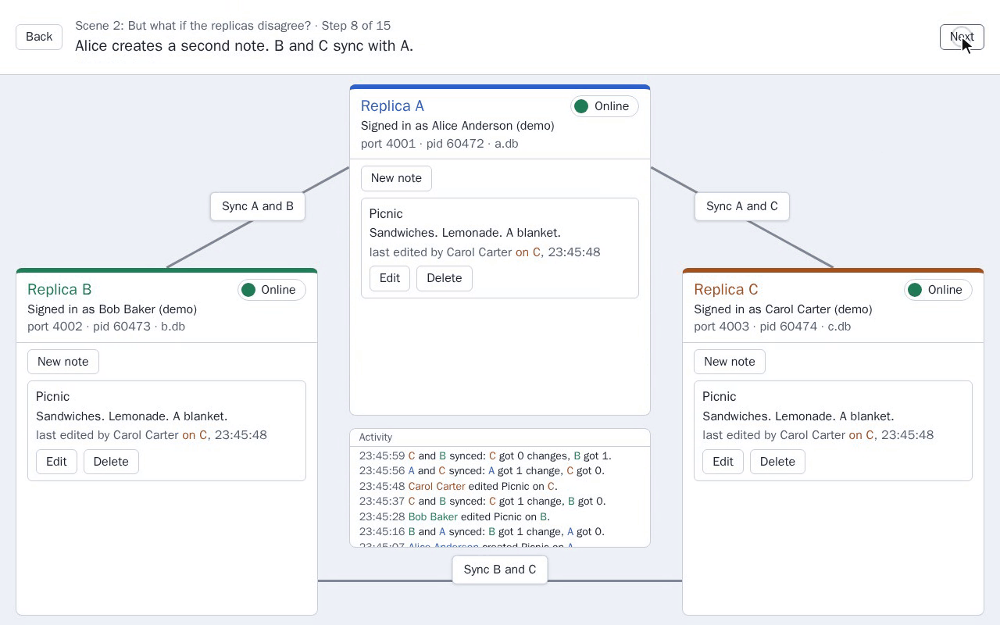

# CromDB

[](https://github.com/skaife/cromdb/actions/workflows/ci.yml)

An embeddable, replicated, offline-first document database with vector-clock conflict detection and document-level access control.

> **Status: 0.x, early but functional.**
>
> What works: documents with access control for the database and
> for each document, queries with paging, replicas that sync with
> each other, and conflicts that are detected, kept, and resolved by
> people or apps rather than silently merged.
>
> Not yet: retiring a lost replica, detecting stale replicas, purging
> deleted documents, backup and restore, and a network transport.
> Until those exist, don't rely on CromDB for data you can't afford
> to lose. The API may change before 1.0.
>
> Next: CromDB Server, then moving databases made by 0.3.0 and earlier
> to user IDs, then replica trust.

## Demo

The repository has a demo: three replicas of one database, each its own process with its own port and file, syncing over HTTP through small servers built on the public API, with a page to drive them.

Three replicas, each its own process: a note travels A to B to C and back, with no conflict.



Two replicas edit the same note offline. All three detect the same conflict and agree on it without a coordinator, and resolving it on one replica settles it everywhere.



To run it from a clone:

```
npm install
npm run demo
```

Then open http://localhost:4000. It runs on this machine only, with no login. See [demo/README.md](demo/README.md).

## What it is

CromDB is a database you embed in your application, not a separate server. It stores schemaless JSON documents, using SQLite underneath.

Each copy of a database (a replica) can be edited on its own, including while offline. Replicas then sync with each other. When two replicas edit the same document, both versions are kept until someone decides between them.

Documents can have a parent through a `parentId` field. Stored documents are never rewritten to fit a new schema, so older documents stay exactly as they were written.

## Install

```
npm install cromdb
```

Requires Node 24.13.1 or newer, and is tested on Linux, Windows and macOS with Node 24. CromDB uses better-sqlite3, a native module. Prebuilt binaries cover Linux, macOS and Windows on x64 and arm64, so no build tools are needed there. On other platforms, installing needs a C++ build toolchain, Python, and `npm install-scripts approve better-sqlite3`, because npm blocks dependency install scripts by default.

## Quick start

Open a database file and a session. A session identifies its user by ID, such as the account ID your sign-in system gives. A new database admits only the session that created it, as its admin; the admin decides who else may read, edit and create documents.

```ts
import { Session, SqliteAdapter } from "cromdb";

// Open (or create) a database file. A session identifies its user by
// ID, such as an account ID from your sign-in system. A new database
// admits only the session that created it, as its admin.
const adapter = SqliteAdapter.open(file);
const alice = Session.withId("alice");
const db = await alice.openDatabase(adapter);

// Let every signed-in user in, to create, read and edit documents.
// Each document's own readers and writers still decide who may read
// and edit it.
const acl = await db.getAcl();
acl.creators = ["*"];
acl.readers = ["*"];
acl.writers = ["*"];
await acl.save();
```

Create, read, edit and find documents:

```ts
// Create a document. readers and writers default to ["*"].
const note = await db.create({ title: "Groceries", items: ["milk"], done: false });
console.log(`alice created ${note.id}`);

// Read it back, edit it in place, and save.
const loaded = await db.get<{ title: string; items: string[]; done: boolean }>(note.id);
if (loaded === undefined) {
  throw new Error("note not found");
}
loaded.content.items.push("eggs");
await loaded.save();
console.log(`items now: ${loaded.content.items.join(", ")}`);

// Another user, on the same database file.
const bob = await Session.withId("bob").openDatabase(adapter);
await bob.create({ title: "Bob's list", items: [], done: false }, { readers: ["bob"], writers: ["bob"] });

// find returns only what the session can read.
const open = await db.find({ where: { done: false } });
console.log(`alice sees ${open.count} open note(s)`);
for await (const doc of await bob.find({ where: { done: false } })) {
  console.log(`bob sees: ${String(doc.content["title"])}`);
}
```

Read a large result in pages:

```ts
// Read a large result in pages: each page has at most limit documents,
// and its next is the after for the following page. next is undefined
// after the last page.
let after: string | undefined;
let pages = 0;
do {
  const page = await bob.find({}, { limit: 100, after });
  pages++;
  console.log(`page ${pages}: ${page.count} document(s)`);
  after = page.next;
} while (after !== undefined);
```

Pages are positions in the order (`createdAt`, then `id`), not a snapshot: each page is read when it is asked for. A document present for the whole pass is seen exactly once, one created during the pass shows up on a later page, and one deleted doesn't. A document that arrives by sync with an earlier `createdAt` than the pass has reached is missed by that pass. A page can hold fewer than `limit` documents and still have a `next`; only an undefined `next` means the end. The cursor works on any replica and after a restart, with the same filter.

## Replication

Make a second replica, edit both, and sync:

```ts
import { Session, SqliteAdapter, sync } from "cromdb";

// The first replica, and an empty adapter for the second.
const adapterA = SqliteAdapter.open(":memory:");
const adapterB = SqliteAdapter.open(":memory:");
const a = await alice.openDatabase(adapterA);

// createReplica copies the database into the empty adapter (admin only).
await a.createReplica(adapterB);
const b = await alice.openDatabase(adapterB);
console.log(`replica ${b.instanceId} of database ${b.databaseId}`);

// Each replica can be edited on its own, including while offline.
await a.create({ city: "Lisbon" });
await b.create({ city: "Osaka" });

// sync pulls each way. Both sessions must be admins.
await sync(a, b);
```

When both replicas edit the same document before syncing, the result is a conflict. Here `task` is a document created on `a` and already synced to `b`:

```ts
// Both replicas edit the same document before syncing.
const onA = await a.get<Task>(task.id);
const onB = await b.get<Task>(task.id);
if (onA === undefined || onB === undefined) {
  throw new Error("task not found");
}
onA.content.status = "done";
await onA.save();
onB.content.status = "blocked";
await onB.save();
await sync(a, b);

// Neither edit is lost. Every replica shows the same version as the
// document (the primary) and keeps the other as a conflict version.
const inConflict = await a.find({ inConflict: true });
console.log(`documents in conflict: ${inConflict.count}`);
const current = await a.get<Task>(task.id);
const conflict = await current?.conflict();
if (current === undefined || conflict === undefined) {
  throw new Error("expected a conflict");
}
for (const version of conflict.versions) {
  console.log(`${version.isPrimary ? "primary " : "conflict"}: ${version.document.content.status}`);
}
```

Resolve it:

```ts
// Editing a document in conflict works, and says the conflict remains.
current.content.title = "Ship 0.1.0 (reviewed)";
const { editedThroughConflict } = await current.save();
console.log(`edited through conflict: ${editedThroughConflict}`);

// A person or the app decides. Here, keep "done" with the new title.
const fresh = await (await a.get<Task>(task.id))?.conflict();
await fresh?.resolveWithContent({ content: { title: "Ship 0.1.0 (reviewed)", status: "done" } });
await sync(a, b);
```

The full programs are in [packages/engine/examples/](packages/engine/examples/). `npm test` runs them.

## Concepts

### Replicas and sync

Each copy of a database is a replica, with its own storage. An admin makes a new replica with `createReplica` when both are in one process, or with a ticket when the new replica is on another machine (see below). Replicas are edited independently and exchange changes with `pullFrom` (one way) or `sync` (both ways), as often or as rarely as suits the app.

Changes travel as batches of plain JSON (`exportChanges` and `applyChanges`), so they can be carried over any transport. CromDB doesn't include a network transport yet, but an app can carry the batches itself. The receiver asks `syncPosition` how far it has got with the source, the source exports the changes after that, and the receiver applies them, repeating while the result's `hasMore` is true:

```ts
// The receiver says how far it has got.
const since = await target.syncPosition(source.instanceId);
const request = JSON.parse(send(JSON.stringify({ since }))) as { since: number };

// The source answers with the changes after that.
const batch = await source.exportChanges({ since: request.since });
const response: unknown = JSON.parse(send(JSON.stringify(batch)));

// The receiver applies them, and stores its new position.
const result = await target.applyChanges(response);
```

Here `send` stands in for the network. The full loop is in [packages/engine/examples/custom-transport.ts](packages/engine/examples/custom-transport.ts). `pullFrom` and `sync` do the same for two databases open in the same process.

Before the batches, the two replicas can check each other with a handshake, so a mismatch (another database, or a replica that needs upgrading) fails with one clear error before anything moves:

```ts
// a sends its hello; b checks it and answers with its own.
const helloA = JSON.parse(send(JSON.stringify(await a.syncHello()))) as SyncHello;
await b.checkPeer(helloA);
const helloB = JSON.parse(send(JSON.stringify(await b.syncHello()))) as SyncHello;

// a checks b's answer. Both now know the level they sync at.
const { level } = await a.checkPeer(helloB);
```

The replica that applies batches is the one that needs the check. For a peer on CromDB 0.2.0 or earlier, which has no handshake, call `checkPeer(undefined)`; such a peer can only sync a level-1 database (see Levels). `pullFrom` and `sync` do the handshake themselves.

A replica can have a name, a display label given to `createReplica(target, { name })` or `registerReplica({ name })`, or to `openDatabase(adapter, { replicaName })` for a new database's first replica. Names travel with sync and needn't be unique. `db.replicas()` lists every replica this one knows about, with its instance ID, name and creation time. Once any replica is named, every replica must run CromDB 0.2.0 or later, since 0.1.x refuses batches carrying a replica's name.

A replica accepts changes only from replicas it knows about. A new replica can always sync with the one it was copied from, and it can sync with the others once they have learned of it, through sync with a replica that already knows it.

To make a replica on another machine, an admin calls `registerReplica` on an existing replica. It registers the new replica and returns a ticket, plain JSON holding the database's system documents. On the other machine, `openDatabase` with `replicaOf` makes an empty adapter that replica, and its first sync, with the replica that wrote the ticket, brings every document:

```ts
// a registers the new replica and sends its ticket. The other side makes
// the replica from it, in an empty adapter of its own.
const ticket = JSON.parse(send(JSON.stringify(await a.registerReplica()))) as ReplicaTicket;
const b = await alice.openDatabase(adapterB, { replicaOf: ticket });
```

The session opening the ticket must be an admin, since the sync that fills the replica needs one. Until that first sync has finished, the new replica is behind, like any replica that hasn't synced: opened is not the same as caught up. A ticket is single-use, so treat it like a database file: opening one ticket twice, on two adapters, makes two replicas with one identity, which sync can't always detect. A ticket that is never used leaves its registration behind, as a replica that never syncs.

### Access

The database has an ACL, a list of users for each access type:

- `readers` may read documents, and `writers` may edit them.
- `creators` may create documents.
- `admins` may change the ACL, make replicas, and sync. Being an admin doesn't let you read or edit documents; that takes `readers` or `writers`.
- `noAccess` overrides every other list: someone in it can't even open the database.

The lists are independent. Editing a document also needs reading it, so someone in `writers` but not `readers` can edit nothing. Someone in `creators` but not `readers` can create documents but not read them back, like a drop box. Anyone in any list but `noAccess` may open the database. A new database lists only the session that created it, so nobody else can open it until an admin adds them. `noAccess` holds user IDs only. An admin can't put themselves in it, at least one admin must stay outside it, and an admin may lock out another admin. `ACCESS_TYPES` lists the access types.

Each document also has its own readers and writers, which can only narrow what the ACL allows. An entry in any list is a user ID, `"*"`, or `"anonymous"`: an ID admits that user, `"*"` admits every signed-in user, and `"anonymous"` admits everyone, including sessions with no user. So the ladder is an ID, then `"*"`, then `"anonymous"`. A document's readers and writers default to `["*"]`, which then means every signed-in user the ACL lets read or edit, never anyone else.

A user ID is 1 to 512 characters from U+0021 to U+007E (ASCII letters, digits and punctuation, no spaces), such as an account ID or an email address. IDs are stored as given and compared exactly, so `"Alice"` and `"alice"` are two users. `"*"`, anything starting with `"["`, and `"system"` and `"anonymous"` in any case are reserved. Show people's names from your own user records; CromDB stores only IDs.

Access is checked on every call, not only when the database is opened, so a change to the ACL takes effect at once, even for a `Database`, `Document` or `Acl` loaded before it. `db.myAccess()` and `doc.myAccess()` say what the session may do, for showing the right buttons; the checks still run.

Every write records who made it. A version whose writer wasn't in its own writers list is treated as unauthorized: it is held as a conflict until a writer confirms it, rather than trusted.

Sync is not limited by the readers lists: a batch holds every document, so an admin who syncs, or who makes a replica, gets every document, even ones the ACL doesn't let them read. Give admin only to people and services you'd trust with all of it.

One adapter can be open in several sessions at once, one `Database` per user, which is how a server serves many users from one file. Each sees the others' writes, ACL changes, conflicts and synced changes as soon as they are made, and each checks its own user's access.

### Levels

Each database has a level, a version of what replicas store and exchange: `db.level`, and `SUPPORTED_LEVELS` for the levels an engine can handle (1 to 3 in this release). Every database this release creates is at level 3, which identifies users by ID and has the ACL described under Access. `db.replicas()` shows the highest level each replica supports, as far as this replica knows.

A database made by CromDB 0.4.0 or 0.5.0 is at level 2. It also identifies users by ID, but its ACL has only creators and admins: everyone may open it, and each document's own lists decide who reads and edits it. It keeps working as before, and syncs with replicas on 0.4.0 and 0.5.0. Its ACL shows readers and writers as `["anonymous"]` and noAccess as `[]`, and they can't be changed there. There is no way yet to move a level-2 database to level 3.

A database made by CromDB 0.3.0 or earlier is at level 1, which identifies users by name: names compare without regard to case. It keeps working as before. Open it with `Session.named(name)`, not `Session.withId`, and it syncs with replicas on 0.2.0 and 0.3.0 as it did. There is no way yet to move a level-1 database to IDs.

Replicas sync only at the same level. CromDB 0.3.0 and earlier can't open or sync a level-2 database, and 0.5.0 and earlier can't open or sync a level-3 one: they refuse it with `UPGRADE_REQUIRED`.

### Versions

`save` refuses with `STALE_DOCUMENT` if the document has changed since it was loaded. A caller that keeps nothing between requests, such as an HTTP API using `If-Match`, gets the same check through `doc.version`: an opaque string, the same on every replica for the same version of a document. Hand it to the client, and when the edit comes back, load the document with `db.get(id, { ifVersion })`, which refuses with `STALE_DOCUMENT` if it has changed since, then edit and save it. `conflict.version` and `doc.conflict({ ifVersion })` do the same for a conflict's set of versions, and `acl.version` and `db.getAcl({ ifVersion })` for the database ACL.

### Conflicts

Each document carries a vector clock, so replicas can tell an edit that follows another from two edits made independently. Independent edits are never silently merged or dropped. Every replica picks the same version as the primary, the one `get` and `find` return, and keeps the others as conflict versions.

A person or the app resolves the conflict: `conflict()` lists the versions, and `resolveWith`, `resolveWithContent` or `resolveByDeleting` writes one version that replaces them. `find({ inConflict: true })` lists documents waiting for a decision. Saving a document that is still in conflict works, and its result has `editedThroughConflict: true`, so the app can prompt the user to resolve it. A resolve call reports the same way: it is true when versions the user can't read are left in conflict.

### Storage

`SqliteAdapter.open(file)` opens or creates a database file, and `":memory:"` opens one that lives only in memory. With `SqliteAdapter.open(file, { exclusive: true })`, the adapter takes the file's lock at open and keeps it until `close`, so no other connection or process can open the file meanwhile: they get `STORAGE_LOCKED`. Use it when one process owns the file, as a server does. The lock is SQLite's own, so the operating system releases it if the process dies, and no lock file is left behind. SQLite's locks aren't reliable on network file systems, so keep database files on a local disk.

### Errors

CromDB's own failures throw `CromDBError`, whose `code` says what went wrong, such as `ACCESS_DENIED` or `STALE_DOCUMENT`; `CromDBErrorCode` lists them all. A minor release can add codes, so code that handles errors should keep a fallback, such as a `default` case that passes on `e.code`. A `Record<CromDBErrorCode, ...>` or an exhaustive `switch` has no fallback: it stops compiling when a code is added, which is what you want only if you want to hear about every new code.

## Limitations

- No way yet to retire a lost replica, or to detect a replica that has been offline too long.
- Deleted documents stay as tombstones; there is no purge yet.
- No backup and restore.
- No network transport (see Replicas and sync).
- Editing the database ACL on two replicas before they sync isn't supported yet: the sync stops with an error.
- Queries are simple: by parent, top-level or orphaned, conflict status, and equality on top-level fields.
- The API may change before 1.0.

Until the items above exist, don't rely on CromDB for data you can't afford to lose.

## API

Everything public is exported from `packages/engine/src/index.ts`, and the doc comments ship in the package's type declarations, so editors show them.

## Development

```
git clone https://github.com/skaife/cromdb.git
cd cromdb
npm install
npm test
npm run typecheck
npm run build
```

## License

MIT, see [LICENSE](LICENSE).
